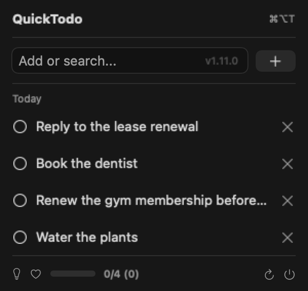
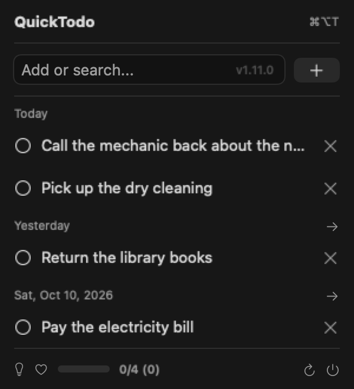
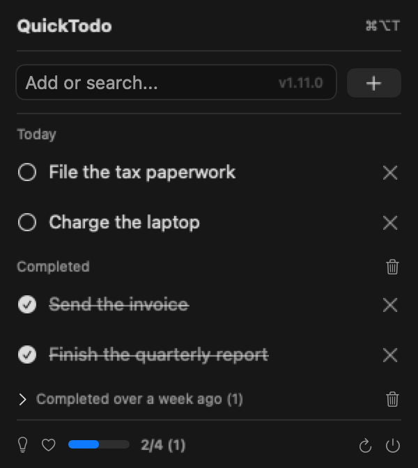
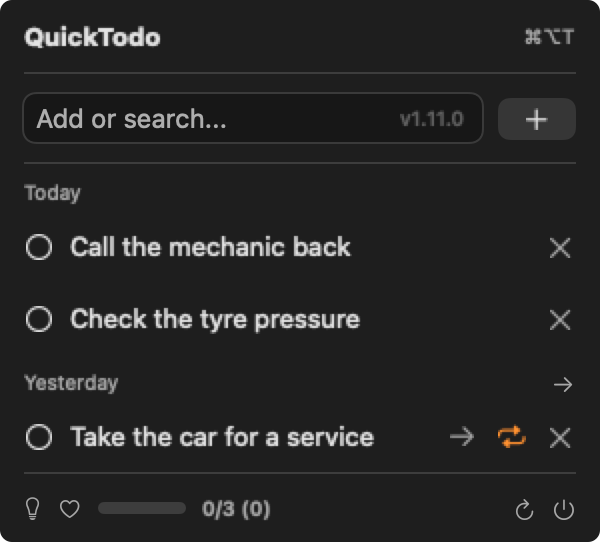

# QuickTodo

A minimal menu-bar todo app for macOS, written in Swift/SwiftUI.
No Electron, no bloat — just a fast native app that lives in your menu bar.



## Install

### via Homebrew (recommended)

```sh
brew tap mdopeace/quicktodo
brew install --cask quicktodo
```

Installs `quicktodo.app` to `/Applications`. The `--cask` flag is optional —
plain `brew install quicktodo` finds it too.

To update to a newer release:

```sh
brew update && brew upgrade quicktodo
```

Or let the app update itself: it checks on launch and when opening the menu
(menu-open checks are limited to once every 4 hours). The footer button always
exists: it spins while checking, turns into ⬇️ when an update is available —
click to download, verify, and install in place — and returns to ↻ as a manual
"check now" button otherwise.

Both routes work and install the same build. Homebrew tracks its own record of
the installed version, so that record can fall out of step with an in-app
update. `brew reinstall --cask quicktodo` re-points it at the tap's version —
which rolls the app back if the tap hasn't published that version yet, so check
`brew info --cask quicktodo` first if you just updated in-app.

### from source

Requires [Homebrew](https://brew.sh) and Xcode Command Line Tools (`swift`, `xcrun`):

```sh
git clone https://github.com/mdopeace/quicktodo
cd quicktodo
./scripts/package.sh local
open dist/quicktodo.app
```

## Requirements

- macOS 13+ (Apple Silicon or Intel)
- Xcode Command Line Tools

## Features

- Native SwiftUI menu-bar UI
- Add with Return; toggle/delete by click (menu tracking consumes key events
  before they reach the hosted view, so no row shortcuts)
- Live search from the same input (3+ characters filters after a 200ms debounce; no match falls back to the full list)
- Progress tracker (completed/total, with week-old completed counted separately)
- Day-grouped list with "Completed" and collapsed "Completed over a week ago" sections, each bulk-clearable
- Move a past-due todo to today — hover a row for the icon beside the repeat button and it moves on one click, or use the section header button to move a whole day at once (confirms first, with the row count). Either way the todo lands at the top of Today
- Tap a row to expand a truncated title
- Drag an active todo to reorder it within its day (not while searching; completed rows can't reorder) — also VoiceOver "Move up"/"Move down" actions
- Repeat a todo daily or weekly — hover a row for the repeat button, then click to cycle the cadence (the icon tints blue/orange); one more click turns it off. Completing a repeating todo creates the next occurrence, dated for that day.
- Rename a todo inline — hover a row for the pencil, then edit the title in place and press Return or click the checkmark; the row's delete button becomes Cancel while editing. Only open todos are editable, and a rename never moves the row to another day or changes its position (also a VoiceOver "Edit" action)
- Global hotkey (⌘⌥T) to open menu
- Registers itself as a login item on launch in release builds (no in-app toggle; disable it in System Settings → General → Login Items)
- Auto-updates via GitHub API (check on launch; on menu-open at most once every 4h; footer button downloads, verifies the SHA-256, replaces the running bundle in place and reopens it)
- Ad-hoc signed, not sandboxed (the in-app updater rewrites its own `.app` bundle on disk, which App Sandbox forbids)

<p align="center">
  
  
  
</p>

<p align="center">
  <sub>Past due, completed, and the hover controls for repeat and move to today.</sub>
</p>

## Notes

- The app is ad-hoc signed for local use. It is not notarized, so the first
  launch may be blocked, and macOS 15 and later removed right-click → Open (the
  popup only offers Done / Move to Bin). Run
  `xattr -dr com.apple.quarantine /Applications/quicktodo.app` once.
- Contributions and issues are welcome, but `main` is branch-protected —
  please open a pull request.

## License

[MIT](LICENSE) © 2026 Md Mostafijur Rahman.

## Links

- Homebrew tap: [mdopeace/homebrew-quicktodo](https://github.com/mdopeace/homebrew-quicktodo)
- Releases: <https://github.com/mdopeace/quicktodo/releases>

## Releases

Changes ship to Homebrew users as versioned releases, not per-commit. To cut a
release, run the **Release** workflow from the Actions tab. Pick a Patch/Minor/
Major bump, or type an exact version to override the bump. The run reads the
current version from `Info.plist` and handles the full flow: version bump via
PR, tag, build on a macOS runner, GitHub Release, then the Homebrew tap cask.

From the terminal, `gh workflow run release.yml -f bump=minor` does the same.

One-time setup: the workflow pushes to the tap using the repository secret
`HOMEBREW_TAP_TOKEN` (Settings → Secrets and variables → Actions). It needs
write access to `mdopeace/homebrew-quicktodo` — the default `GITHUB_TOKEN`
cannot reach another repo, so without it the release publishes and only the tap
update fails.

Users then update with `brew update && brew upgrade quicktodo`.
